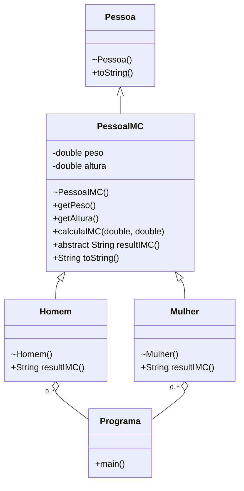
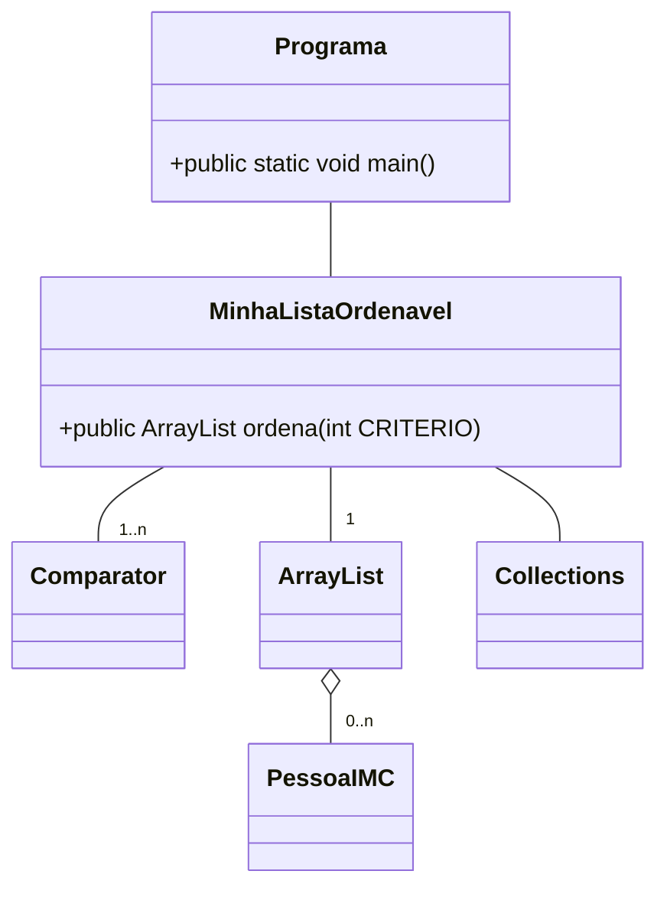

# Programa 2 - P2n

Este programa será dividido em duas partes:

1. Na primeira parte você vai reusar todas as classes do P1n. Pode copiar os arquivos Java para o diretório deste novo programa P2n. Vamos modificar o P1n para calcular o IMC. Isso é apenas uma reestruturação para desenvolver a 2ª parte. Não temos aqui entrada de dados, etc. Apenas preparando a nova infraestrutura de classes.
2. Na 2ª parte, vamos criar manualmente 5 objetos da classe Mulher e 5 objetos da classe Homem, e colocar um objeto da classe ArrayList. Depois vamos permitir o usuário listar e ordenar estes objetos por vários critérios.

## Parte 1.

O IMC de uma pessoa pode ser calculado através de uma fórmula que consiste em dividir o peso (em kg) pelo quadrado da altura (em m²). O número resultante é então verificado em uma escala que varia de acordo com o seu gênero e então se chega a um resultado. Sua tarefa, neste exercício, é realizar o cálculo do IMC usando dados fornecidos pelo(a) usuário(a) e analisar a escala a fim de mostrar se ele(a) está acima, na média ou abaixo do peso ideal

a) Você vai reusar a classe Pessoa e modificar levemente as classes Homem e Mulher.

Exclua o seguinte (mas copie em algum lugar, pois vamos usá-los na classe PessoaIMC:

- os campos peso e altura;
- os métodos get e set relativos a estes dois campos, se você fez;
- e exclua as informações relativas a estes campos do método toString da classe Pessoa.

b) Crie a classe abstrata PessoaIMC que herde da classe Pessoa.

Traga os trechos de código dos campos peso e altura, ambos do tipo float. Faça estes campos protegidos.

PessoaIMC deve ter construtores que se "alinhem" com os construtores de Pessoa e receba adicionalmente dois valores do tipo float que inicializar os campos peso e altura. Os demais campos devem ser tratados usando as técnicas de herança e encapsulamento.

A classe PessoaIMC deve conter os seguintes métodos:

- public float getPeso() que retorna o peso;
- public float getAltura() que retorna a altura;
- calculaIMC() que utiliza os valores dos campos altura e o peso e retorna um valor do tipo float correspondente ao IMC (Índice de Massa Corporal = peso / altura ao quadrado) calculado.
- o método abstrato resultIMC() que não recebe parâmetros e retorna uma instância da classe String. (o método não é implementado nesta classe - ele é abstrato)
- O método toString() desta classe deve retornar uma string que exiba as informações da pessoa na seguinte forma sugerida (um bom lugar para você exercer o reuso de código por herança):

d) Modifique as classes Homem e Mulher de P1n, que agora vão herdar de PessoaIMC. Cada uma deve implementar, além o que já fazia em P1n, o método abstrato resultIMC() herdado de PessoaIMC para classificar o cálculo do IMC (o cálculo efetivo é realizado pelo método calculaIMC).

```
Nome: <nome da pessoa> 
Data de Nascimento: <sua data de nascimento> 
Peso: <seu peso> Altura: <sua altura>
```

A classificação do IMC, indicando se a pessoa está abaixo, acima ou com o peso ideal é dada pela tabela abaixo:

| Para Homem:                       | Para Mulher:                     |
|-----------------------------------|----------------------------------|
| IMC < 20.7 : Abaixo do peso ideal | IMC < 19 : Abaixo do peso ideal  |
| 20.7 ≤ IMC ≤ 26.4: Peso ideal     | 19 ≤ IMC ≤ 25.8: Peso ideal      |
| IMC > 26.4 : Acima do peso ideal  | IMC > 25.8 : Acima do peso ideal |

Assim a string retornada deve indicar em que faixa estão a Mulher ou Homem.

O método toString() retorna um objeto da classe String com o resultado de acordo com o valor obtido e todos as demais informações da pessoa, inclusive se o objeto é da classe Mulher ou Homem. É claro que se você colocar um campo para rotular o gênero, isso está errado.

Evite usar GENERICS "&lt;tipo&gt;", já que queremos usar instanceof e casting, como fizemos em P1n.

Com isso agora temos a infraestrutura para fazer a parte 2.

O diagrama de classes desta primeira parte está exibido na Figura 1.



Figura1. Diagrama de classe PessoaIMC - Homem - Mulher - Parte1

## Parte 2

a) Crie uma classe chamada MinhaListaOrdenavel.

1) Esta classe vai conter um objeto da classe ArrayList, do pacote java.util. A classe ArrayList implementa a interface Collection - isso é importante para o programa.

Este objeto vai colecionar objetos da classe PessoaIMC, que pode ser Mulher ou Homem - ou seja não vão se criar objetos PessoaIMC, mas sim objetos das classes Homem e Mulher e, em cima dele, vamos fazer as várias ordenações.

2) Crie métodos void add(PessoaIMC p) e PessoaIMC get(index i) para adicionar e resgatar, respectivamente, objetos das classes Homem e/ou Mulher do ArrayList interno. Estamos presumindo que você não vai, nesta implementação, verificar os elementos a serem inseridos (set) ...esse não é o objetivo, então não temos retorno de erro nem exceções sendo jogadas.

3) Crie múltiplas formas de ordenar sua lista de PessoaIMC (nome AZ, e Z-A, peso, altura, IMC, gênero).

### Siga as orientações a seguir.

Vamos usar a interface Comparator e um "truque" de programação em Java: definir uma classe dentro de outra e criar uma instância dela - tudo embutido, chamado de classe anônima.

Para cada tipo de ordenação que queremos ter, ou seja, comparando valores inteiros, float ou Strings, data de nascimento, etc., temos que ter uma classe específica que herde da Comparator.

A que compara inteiros números, de ponto flutuante - ou não, vai pegar um campo, digamos o peso ou a altura, de dois objetos da classe PessoaIMC (que podem ser objetos das classes Homem ou Mulher), e usar o método de classe compare() das Wrapper Classes numéricas como Integer e Float. Se for da classe String, podem usar os métodos da própria classe String para fazer a comparação. Isso é o suficiente para se usar os métodos de ordenação.

Exemplo de classe anônima:

```
public Comparator<PessoaIMC> pesoC = new Comparator<PessoaIMC> () { 
    @Override 
    public int compare(PessoaIMC p1, PessoaIMC p2){ 
        float peso1, peso2; 
        peso1 = p1.getPeso(); 
        peso2 = p2.getPeso(); 
        return Float.compare(peso1, peso2); 
        //Faça testes para ver se funciona, de fato. 
    } 
};
```

Se preferir, para interfaces com apenas um método a ser implementado como o Comparator, pode aplicar também expressão lambda dessa forma:

```
public Comparator<PessoaIMC> pesoC = (p1, p2) -> { 
    float peso1, peso2; 
    peso1 = p1.getPeso(); 
    peso2 = p2.getPeso(); 
    return Float.compare(peso1, peso2); 
    //Faça testes para ver se funciona, de fato. 
};
```

Procure um tutorial para mais detalhes sobre classe anônima e expressão lambda Observe que vamos ter um objeto chamado pesoC (o nome seria uma contração de peso+Comparator) "dentro" do (objeto) MinhaListaOrdenavel. Da mesma forma vamos ter vários outros comparadores encapsulados.

Queremos que você construa comparadores e permita a ordenação, no mínimo, pelos seguintes critérios, em ordem crescente e decrescente:

- Nome
- Peso
- IMC
- Mulher ou Homem (o que você vai considerar aqui como ordem crescente ou decrescente não importa)
- Idade
- Data de nascimento (para isso tem que ter implementado bem a classe Pessoa e ter feito uso correto da classe GregorianClendar ou LocalDate)
- CPF

4) Crie um método ordena, que vai receber uma constante, de uma "tabela" de constantes que você vai criar dentro da classe MinhaListaOrdenavel e vai devolver um objeto da classe ArrayList, com os objetos da classe PessoaIMC ordenados segundo o critério da constante.

Exemplo:

```
1.Alfabetica (A-Z) - nome da pessoa 
2.Alfabetica (Z-A) - nome da pessoa 
3.Menor Peso - crescente 
4.Maior Peso - decrescente 
5.Menor IMC - crescente, do mais baixo para o mais alto 
... 
X.Homem / Mulher - ordenar por gênero 
[...] outros solicitados
```

5) Para efetivar a ordenação você vai usar o método de classe sort da classe Collections (Atenção: lá no início, dissemos que ArrayList implementa a interface Collection. Agora estamos mencionando a classe Collections - com "s" no final - esta classe é que oferece o método sort - leiam a documentação). Observe que a classe Collections só tem métodos de classe (static) para ser aplicado a objetos de coleção - mais um exemplo de utilidade dos métodos de classe.

Exemplo de como estruturar o uso do sort:

```
public ArrayList ordena (int critério) { 
    
    ...switch (critério) { 
        case PESO: 
            Collections.sort(this.[ArrayList encapsulado] , pesoC); `
            // passamos o próprio ArrayList encapusado dentro de MinhaListaOrdenavel 
            // e o Comparator correspondente ao critério 
        case PESO_REVERSO: 
            Collections.sort(this.[ArrayList encapsulado] , pesoC.reversed()); 
            // observe que a única diferença é a chamada a reversed() 
    ...
    return this.[ArrayList encapsulado]; 
}
```

Obs: Na interface List (e consequentemente a classe ArrayList), também existe um método chamado sort() em que passamos um Comparator como argumento sem precisar da classe Collections. Você pode usar, mas incentivamos o uso da Collections.

```
...switch (critério) {
    case PESO: 
        this.[ArrayList encapsulado].sort(pesoC); 
    case PESO_REVERSO: 
        this.[ArrayList encapsulado].sort(pesoC.reversed()); 
        // observe que a única diferença é a chamada a reversed() ... 
    return this.[ArrayList encapsulado]; 
}
```

b) Crie agora a classe principal do programa, P2nX, que vai conter uma instância de objeto da classe MinhaListaOrdenavel e partir dela algumas operações serão efetuadas.

- Crie um objeto da classe MinhaListaOrdenavel.
- Em seguida, crie "na mão" 10 objetos da classe PessoaIMC (5 da classe Homem e 5 da classe Mulher) e insira no objeto MinhaListaOrdenavel. Observe que NÃO estamos pedindo para você fazer uma rotina de entrada de dados. Isso foi feito em P1n e vai ser reforçado no próximo programa.
- Na sequência crie um menu para o usuário imprimir a lista de objetos inseridos ou sair do programa. Se o usuário optar por listar, pergunte qual o critério e liste os produtos.



Figura 2. Diagrama de classe P2n

PS.: Para simplificar as coisas, pode colocar estas etapas dentro do método main. No próximo exercício vamos organizar melhor as coisas.

Exemplo:

```
    1.Imprimir Lista 
    2.Sair 
Digite sua opcao: 1 
    Escolha seu modo de ordenacao 
    1.Alfabetica (A-Z) 
    2.Alfabetica (Z-A) 
    3.Menor Peso 
    4.Maior Altura 
    5.Menor IMC
    ## [...] etc
Digite sua opcao: 5 
[listar as pessoas na ordem correta, exibindo as informações completas de cada pessoa - isso já deveria estar incluído no toString]

    1.Imprimir Lista 
    2.Sair
Digite sua opcao: A 
Opcao invalida!!

    1.Imprimir Lista 
    2.Sair 
Digite sua opcao: A

    Escolha seu modo de ordenacao 
    1.Alfabetica (A-Z) 
    2.Alfabetica (Z-A) 
    3.Menor Peso 
    4.Maior Altura 
    5.Menor IMC 
    [...] etc 
[listar as pessoas na ordem correta, exibindo as informações completas de cada pessoa - isso já deveria estar incluído no toString]

Digite sua opcao: [ENTER]

C:\lp2\gXX\P2n&gt;
```

A exibição de cada elemento da lista deve ser completa e organizada. Se você fez direito, isso tudo está no toString devidamente encapsulado.

Tem que exibir necessariamente a classe do objeto (se é homem ou mulher), o IMC, a avaliação do IMC, etc.

Exemplo (incompleto - só para oferecer uma ideia).

```
-------- 
Nome: Zezinho (Homem) 
Data de Nascimento: 01/01/1965 
CPF: 123.456.789-01 
Peso: 85.3 
Altura: 1.71 
Idade: 59 anos 
IMC: 34.9 Acima do peso 
-------- 
-------- 
Nome: Mariazinha (Mulher) 
Data de Nascimento: 02/02/1992 
CPF: 123.456.789-01 
Peso: 62.8 
Altura: 1.75 
Idade: 22 anos 
IMC: 19.3 Peso ideal
--------
```